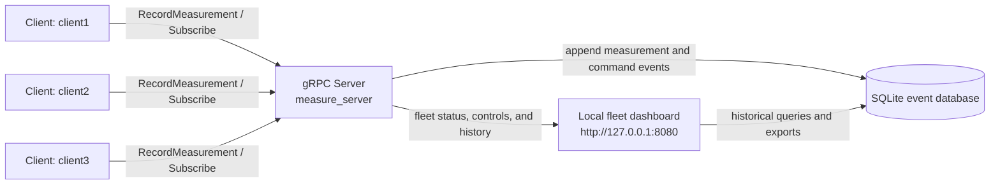

# Measure

`Measure` is a small gRPC-based measurement system:
- one server accepts measurements from multiple clients
- each client can subscribe to server-pushed threshold commands
- the server exposes a localhost-only fleet dashboard for device status,
  threshold configuration, calibration, measurement charts, and recent events
- dashboard panels can be rearranged with drag and drop

## Overview

Clients generate measurements and, in the current sample client, send values
above the active threshold to the server. The server stores each received
measurement and operator command in a SQLite event database for the localhost
dashboard.

## Architecture



## Build

### Build the dashboard frontend

The React dashboard is a separate app in `dashboard/`. Build its static files
before starting the C++ server:

```bash
cd dashboard
npm ci
npm run build
cd ..
```

For UI development, run the C++ server in one terminal and the Vite dev server
in another. The Vite server proxies `/api` requests to the local C++ server:

```bash
cd dashboard
npm run dev
```

### Option 1: use installed protobuf and gRPC

```bash
cmake -S . -B build -DCMAKE_PREFIX_PATH="$MY_INSTALL_DIR"
cmake --build build --parallel 4
```

### Option 2: let CMake fetch protobuf and gRPC

If protobuf and gRPC are not already installed locally:
```bash
cmake -S . -B build -DGRPC_FETCHCONTENT=ON
cmake --build build --parallel 4
```

CMake generates the protobuf and gRPC sources as part of the build.

The build also requires the SQLite3 development headers and library.

## Tests

Catch2 v3 unit and gRPC integration tests are available through CTest. The
integration tests verify that subscribers receive threshold and calibration
commands and that measurement RPCs acknowledge and store measurements. Enable
tests when configuring:
```bash
cmake -S . -B build -DBUILD_TESTING=ON -DGRPC_FETCHCONTENT=ON
cmake --build build --parallel 4
ctest --test-dir build --output-on-failure
```

## Run

Start the server:
```bash
./build/measure_server --port=50051 --http_port=8080 --samples_retained=500 \
  --server_cert=/etc/measure/server.crt \
  --server_key=/etc/measure/server.key \
  --client_ca=/etc/measure/device-and-operator-ca.crt
```

The server stores events in `measure.db` by default. Configure its location with
`--database_path=/path/to/measure.db`. Retention is unlimited by default; set
`--retention_days=365` to remove older events at startup and as new events are
recorded. `--samples_retained` controls only the recent dashboard device view,
not the database history.

The server serves the built React app from `dashboard/dist`. Use
`--web_root=/path/to/dashboard/dist` to select another frontend build directory.

Start one or more clients with different IDs:
```bash
./build/measure_client --target=localhost:50051 --client_id=client1 \
  --root_cert=/etc/measure/server-ca.crt \
  --client_cert=/etc/measure/client1.crt \
  --client_key=/etc/measure/client1.key
./build/measure_client --target=localhost:50051 --client_id=client2 \
  --root_cert=/etc/measure/server-ca.crt \
  --client_cert=/etc/measure/client2.crt \
  --client_key=/etc/measure/client2.key
```

Open the fleet dashboard:
```text
http://127.0.0.1:8080/
```

## Dashboard

The dashboard provides:

- connected/offline device status, latest reading, and last-seen time
- fleet-wide threshold updates pushed to subscribed clients
- calibration for all connected clients or one selected device
- recent measurement chart and event history
- draggable dashboard panels; their order is saved in the browser

The dashboard and its control endpoints are bound to localhost only. Mutating
requests require a same-origin request from the dashboard.

## Authentication and authorization

The gRPC listener requires mutual TLS. Configure the server certificate and
private key, and a CA certificate trusted to issue client certificates. Clients
also require the CA that issued the server certificate and their own certificate
and private key. Missing credentials, untrusted certificates, and insecure gRPC
connections are rejected.

The trusted client CA is the identity authority. It must issue certificates with
one of these common names:

- `device:<client_id>` for a device. `RecordMeasurement` and `Subscribe` require
  the certificate identity to match the RPC's `client_id`.
- `operator:<name>` for an operator. `SetCalibrationMode` requires an operator
  certificate. For example, run the client in calibration mode with the
  operator's certificate and key:

  ```bash
  ./build/measure_client --target=localhost:50051 --calibrate=true \
    --root_cert=/etc/measure/server-ca.crt \
    --client_cert=/etc/measure/operator.crt \
    --client_key=/etc/measure/operator.key
  ```

Protect private keys and issue device and operator certificates only through
your trusted PKI. The dashboard remains bound to `127.0.0.1`; its same-origin
check is not user authentication, so do not expose its HTTP port to a network.
Calibration events record the authenticated operator certificate identity.
Dashboard-originated actions are identified as `localhost_dashboard`.

This establishes authenticated device identity and basic operator authorization.
The current command stream is still transient: command IDs, device acknowledgments,
durable pending commands, retry/reconnect guarantees, and per-device outcomes
remain follow-up work. Tenant and device-group modeling and bulk targeting are
also outside this slice and belong to issue #10.

The dashboard data is available from:

```text
GET  http://127.0.0.1:8080/api/dashboard
GET  http://127.0.0.1:8080/api/history?since_ms=...&until_ms=...&limit=...
GET  http://127.0.0.1:8080/api/trends?bucket_ms=3600000
GET  http://127.0.0.1:8080/api/export?format=csv
GET  http://127.0.0.1:8080/api/export?format=json
POST http://127.0.0.1:8080/api/threshold
POST http://127.0.0.1:8080/api/calibration
```

History queries accept optional `since_ms`, `until_ms`, `client_id`, and
`limit` parameters. Trend queries return per-device count, average, minimum,
and maximum measurement values grouped into time buckets. Exports accept the
same time and client filters and include both measurement and command events.

Threshold and calibration requests use URL-encoded form fields. For example,
from the dashboard origin:

```text
threshold=5
client_id=client1&duration_seconds=10
```

## Data and behavior notes

- The dashboard is only exposed on localhost.
- Each recorded measurement includes:
  - `point`
  - `client_id`
  - `timestamp_unix_ms`
- Measurements, threshold changes, and calibration commands are stored as
  append-only events in SQLite. Event rows include a type, timestamp, optional
  measurement/command fields, and a JSON payload for forward-compatible event
  data. Calibration lifecycle events also record the authenticated operator
  identity when invoked over gRPC.
- The dashboard history, charts, and device readings are loaded from the
  database. Connected status and the currently connected clients are transient.
- Clients subscribe to threshold updates from the server using gRPC streaming.
- The threshold is shared by all clients; calibration can target one connected
  client or all clients.
