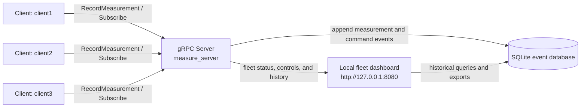

# Measure

`Measure` is a small gRPC-based measurement system:
- one server accepts measurements from multiple clients
- each client can subscribe to server-pushed threshold commands
- the server exposes a localhost-only fleet dashboard for device status,
  threshold configuration, calibration, measurement charts, and recent events
- dashboard panels can be rearranged with drag and drop

## Overview

Clients generate measurements and, in the current sample client, send values
above the active threshold to the server. The server stores each received
measurement and operator command in a SQLite event database for the localhost
dashboard.

## Architecture



## Build

### Build the dashboard frontend

The React dashboard is a separate app in `dashboard/`. Build its static files
before starting the C++ server:

```bash
cd dashboard
npm ci
npm run build
cd ..
```

For UI development, run the C++ server in one terminal and the Vite dev server
in another. The Vite server proxies `/api` requests to the local C++ server:

```bash
cd dashboard
npm run dev
```

### Option 1: use installed protobuf and gRPC

```bash
cmake -S . -B build -DCMAKE_PREFIX_PATH="$MY_INSTALL_DIR"
cmake --build build --parallel 4
```

### Option 2: let CMake fetch protobuf and gRPC

If protobuf and gRPC are not already installed locally:
```bash
cmake -S . -B build -DGRPC_FETCHCONTENT=ON
cmake --build build --parallel 4
```

CMake generates the protobuf and gRPC sources as part of the build.

The build also requires the SQLite3 development headers and library.

## Quick demo deployment

Docker Compose builds the server and dashboard, generates local demo-only
certificates, starts a sample device, and persists the event database:

```bash
docker compose up --build
```

Open the dashboard at <http://127.0.0.1:8080/>. The sample device generates
measurements automatically. To issue a ten-second calibration command from a
second terminal:

```bash
docker compose run --rm demo-operator
```

Stop the demo with Ctrl+C or `docker compose down`; both leave the database and
demo certificates in Docker-managed volumes. To remove those volumes and reset
the demo, run `docker compose down -v`.

Server, device, and operator credentials live in separate volumes. Only the
certificate generator mounts all three; each runtime container mounts only its
own credentials and the public CA certificate. The CA private key is temporary
and is not persisted. Upgrading from the earlier shared-volume demo generates
new role-specific credentials without removing the measurement database.
The old shared `demo-certificates` volume is no longer mounted and should be
removed after stopping containers that still use it.

Saved credentials are checked for expiry, trust, matching private keys, and
expected demo identities before reuse. Invalid or incomplete credentials stop
startup with an error; they are not silently replaced.
To reset only the demo certificates **without deleting measurements**, stop the
stack, remove the generated role credentials, and start again:

```bash
docker compose down
docker compose run --rm --no-deps --entrypoint sh demo-certificates -c '
  set -eu
  for role in server device operator; do
    directory="/run/measure/demo-certificates/$role"
    rm -f "$directory/ca.crt" "$directory/$role.crt" "$directory/$role.key"
  done
'
docker compose up --build
```

Do not use `down -v` for this recovery: that also deletes the measurement database.

The demo publishes its dashboard and gRPC ports only on host loopback. Its
health check uses a small native HTTP probe with a two-second deadline rather
than curl, so the runtime image needs neither curl nor Debian's Brotli library.
The image build rejects installed Brotli packages in the final runtime stage;
this does not cover dependencies in the separate build stages.
The probe checks the dashboard API on its demo port, 8080.
The generated credentials are for local demonstration only and must not be reused
for tests or production. This is not yet a production deployment: separate test
and production configurations, managed credentials, backup/restore, and
upgrade procedures remain future work. The server already accepts explicit
listener, database, web-root, and certificate paths, keeping those deployment
environments separable from the demo configuration.

## Tests

Catch2 v3 unit and gRPC integration tests are available through CTest. The
integration tests verify that subscribers receive threshold and calibration
commands, acknowledge their application, and reconnect after server restarts.
They also cover calibration expiry, latest-wins state recovery, bounded offline
buffering, and idempotent measurement retries. Enable
tests when configuring:
```bash
cmake -S . -B build -DBUILD_TESTING=ON -DGRPC_FETCHCONTENT=ON
cmake --build build --parallel 4
ctest --test-dir build --output-on-failure
```

The dashboard tests include invalid bind addresses, occupied ports, and listener
restart. Address and bind failures terminate server startup with a nonzero exit.
Demo credential regression tests run as root in the demo image (they create only
temporary test credentials and do not mount the deployment's data volumes):

```bash
docker compose build
docker run --rm --user 0:0 \
  --mount type=bind,source="$(pwd)/tests",target=/tests,readonly \
  --entrypoint sh measure:demo /tests/demo_credentials_tests.sh
```

## Run

Start the server:
```bash
./build/measure_server --port=50051 --http_port=8080 --samples_retained=500 \
  --server_cert=/etc/measure/server.crt \
  --server_key=/etc/measure/server.key \
  --client_ca=/etc/measure/device-and-operator-ca.crt
```

The server stores events in `measure.db` by default. Configure its location with
`--database_path=/path/to/measure.db`. Retention is unlimited by default; set
`--retention_days=365` to remove older events at startup and as new events are
recorded. `--samples_retained` controls only the recent dashboard device view,
not the database history.

The server serves the built React app from `dashboard/dist`. Use
`--web_root=/path/to/dashboard/dist` to select another frontend build directory.

Start one or more clients with different IDs:
```bash
./build/measure_client --target=localhost:50051 --client_id=client1 \
  --root_cert=/etc/measure/server-ca.crt \
  --client_cert=/etc/measure/client1.crt \
  --client_key=/etc/measure/client1.key
./build/measure_client --target=localhost:50051 --client_id=client2 \
  --root_cert=/etc/measure/server-ca.crt \
  --client_cert=/etc/measure/client2.crt \
  --client_key=/etc/measure/client2.key
```

Open the fleet dashboard:
```text
http://127.0.0.1:8080/
```

## Dashboard

The dashboard provides:

- connected/offline device status, latest reading, and last-seen time
- per-device command state: applied, awaiting acknowledgment, or pending reconnect
- fleet-wide threshold updates pushed to subscribed clients
- calibration for all connected clients or one selected device
- recent measurement chart and event history
- draggable dashboard panels; their order is saved in the browser

The dashboard and its control endpoints are bound to localhost only. Mutating
requests require a same-origin request from the dashboard.

## Authentication and authorization

The gRPC listener requires mutual TLS. Configure the server certificate and
private key, and a CA certificate trusted to issue client certificates. Clients
also require the CA that issued the server certificate and their own certificate
and private key. Missing credentials, untrusted certificates, and insecure gRPC
connections are rejected.

The trusted client CA is the identity authority. It must issue certificates with
one of these common names:

- `device:<client_id>` for a device. `RecordMeasurement` and `Subscribe` require
  the certificate identity to match the RPC's `client_id`.
- `operator:<name>` for an operator. `SetCalibrationMode` requires an operator
  certificate. For example, run the client in calibration mode with the
  operator's certificate and key:

  ```bash
  ./build/measure_client --target=localhost:50051 --calibrate=true \
    --root_cert=/etc/measure/server-ca.crt \
    --client_cert=/etc/measure/operator.crt \
    --client_key=/etc/measure/operator.key
  ```

Protect private keys and issue device and operator certificates only through
your trusted PKI. The dashboard remains bound to `127.0.0.1`; its same-origin
check is not user authentication, so do not expose its HTTP port to a network.
Calibration events record the authenticated operator certificate identity.
Dashboard-originated actions are identified as `localhost_dashboard`.

This establishes authenticated device identity and basic operator authorization.
Tenant and device-group modeling and bulk targeting remain outside this slice
and belong to issue #10.

## Delivery and recovery guarantees

Commands represent **latest desired state**, not a queue of actions to replay.
The server commits each state change and its audit event to SQLite before
publishing it. Each change has a monotonically increasing revision, which
survives server restarts. A reconnecting device receives only its latest state.
This also establishes the delivery model for future destination commands:
reconnect should restore the latest destination, not replay earlier directions.

- A fleet threshold update supersedes earlier threshold and calibration state,
  including state for disconnected devices. New devices receive that threshold.
- Calibration targets one named device (including an offline device through
  gRPC), or a snapshot of all currently connected devices for a broadcast.
  Its absolute expiry is fixed at acceptance, not at delivery or reconnection.
  Reconnecting before expiry resumes only the remaining time; reconnecting
  after expiry receives normal state. The client also restores the normal
  threshold locally at expiry if disconnected. Device/server clocks must be
  synchronized for this deadline behavior.
- A newer calibration replaces an older calibration for the same device; old
  deadlines cannot cancel the replacement. A single server delivery worker
  restores expired state, including after a restart.
- Devices acknowledge **application** of a revision through
  `AcknowledgeCommand`. A successful stream write is not an acknowledgment.
  The server retries unacknowledged latest state about once per second and
  stores per-device acknowledged revisions and audit events. Duplicate
  acknowledgments are idempotent; superseded, expired, or unknown revisions
  are rejected. The dashboard distinguishes saved state from device application.
- Each subscription retains at most one in-flight and one newest pending
  snapshot. A replacement connection cannot be unregistered by the old
  connection's cleanup.

The client reconnects with exponential backoff (100 ms to 5 seconds, plus up to
25% jitter). Subscription attempts have a 30-second deadline so a broken
connection does not remain undetected indefinitely. Authentication, authorization,
and incompatible-protocol failures stop the client rather than retrying forever.
The client waits for its initial state before generating readings, continuing
to reconnect if the server is unavailable. It then samples every three seconds
until Ctrl+C (or SIGTERM) or `q` followed by Enter. Terminal input and shutdown
remain responsive between samples without a blocking sampling sleep. Closed
stdin does not stop a headless client. Permanent RPC failures still exit nonzero.

Measurement delivery uses gRPC status and a `MeasurementReceipt`, replacing the
old thumbs response. `OK` means storage committed; errors are never reported as
success. The client assigns a stable measurement ID and timestamp before
buffering, retries transient failures with a two-second RPC deadline, and checks
that the receipt matches the ID. SQLite deduplicates `(client_id, measurement_id)`
across retries and server restarts, even if the original response was lost.
Reusing an ID with different data is rejected. Deduplication receipts are kept
independently of history retention and currently have no automatic pruning.

Measurement ingestion is bounded by `--max_concurrent_measurements=4` by default,
allowing small bursts while SQLite serializes writes. The limit must be positive and covers
measurement handlers entering storage, including those waiting for the event
store lock. Admitted work runs on a fixed-size worker pool rather than blocking
gRPC callback threads; queued plus running work cannot exceed the limit.
Excess requests return `RESOURCE_EXHAUSTED` immediately without
storing or acknowledging the reading. Clients retain those readings and retry
with exponential backoff and jitter. Permits are released on both success and
storage errors. This is admission control, not a server-side measurement queue
or a sustained-rate limit; command RPCs do not consume measurement permits.

The client's offline measurement buffer is FIFO, bounded to 1,000 entries, and
**memory-only**: it survives network disconnects, not process exits. A full buffer
explicitly rejects new readings instead of dropping old readings. The sample
stops sampling on shutdown, waits up to 30 seconds to drain before exiting, and exits nonzero if anything is
undelivered. Deployments requiring client-crash recovery need a durable local
outbox; no exactly-once physical action guarantee is claimed.

### Protocol compatibility

`ClientInfo.protocol_version=1` enables versioned commands and acknowledgments.
Unknown subscription versions are rejected with `FAILED_PRECONDITION`.
Version 0 remains accepted for old clients, but does not provide application
acknowledgments or automatic command retries, and old clients do not enforce
calibration expiry while offline. New clients require version 1 responses.

Existing measurement request fields and RPC names are unchanged. The old
response's field 1 is reserved, so old protobuf clients can decode the new
receipt, but should use gRPC status for success. Measurements without an ID
remain accepted for legacy clients and cannot be deduplicated. Calibration
duration 0 retains the legacy ten-second default; other durations must be
between 1 and 3,600 seconds. SQLite adds the delivery and receipt tables on
startup without discarding existing events.

The dashboard data is available from:

```text
GET  http://127.0.0.1:8080/api/dashboard
GET  http://127.0.0.1:8080/api/history?since_ms=...&until_ms=...&limit=...
GET  http://127.0.0.1:8080/api/trends?bucket_ms=3600000
GET  http://127.0.0.1:8080/api/export?format=csv
GET  http://127.0.0.1:8080/api/export?format=json
POST http://127.0.0.1:8080/api/threshold
POST http://127.0.0.1:8080/api/calibration
```

History queries accept optional `since_ms`, `until_ms`, `client_id`, and
`limit` parameters. Trend queries return per-device count, average, minimum,
and maximum measurement values grouped into time buckets. Exports accept the
same time and client filters and include both measurement and command events.

Threshold and calibration requests use URL-encoded form fields. For example,
from the dashboard origin:

```text
threshold=5
client_id=client1&duration_seconds=10
```

## Data and behavior notes

- The dashboard is only exposed on localhost.
- Each recorded measurement includes:
  - `point`
  - `client_id`
  - `timestamp_unix_ms`
- Measurements, threshold changes, and calibration commands are stored as
  append-only events in SQLite. Event rows include a type, timestamp, optional
  measurement/command fields, and a JSON payload for forward-compatible event
  data. Calibration lifecycle events also record the authenticated operator
  identity when invoked over gRPC.
- The dashboard history, charts, and device readings are loaded from the
  database. Connected status and the currently connected clients are transient.
- Clients subscribe to threshold updates from the server using gRPC streaming.
- The threshold is shared by all clients; calibration can target one connected
  client or all clients.
